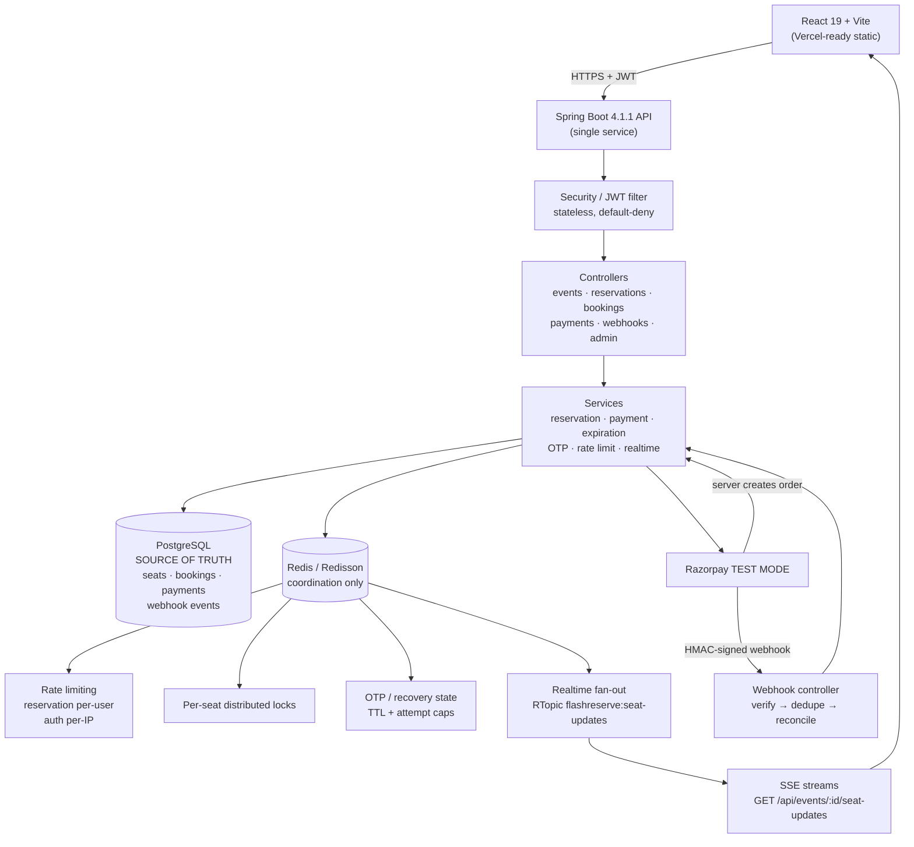
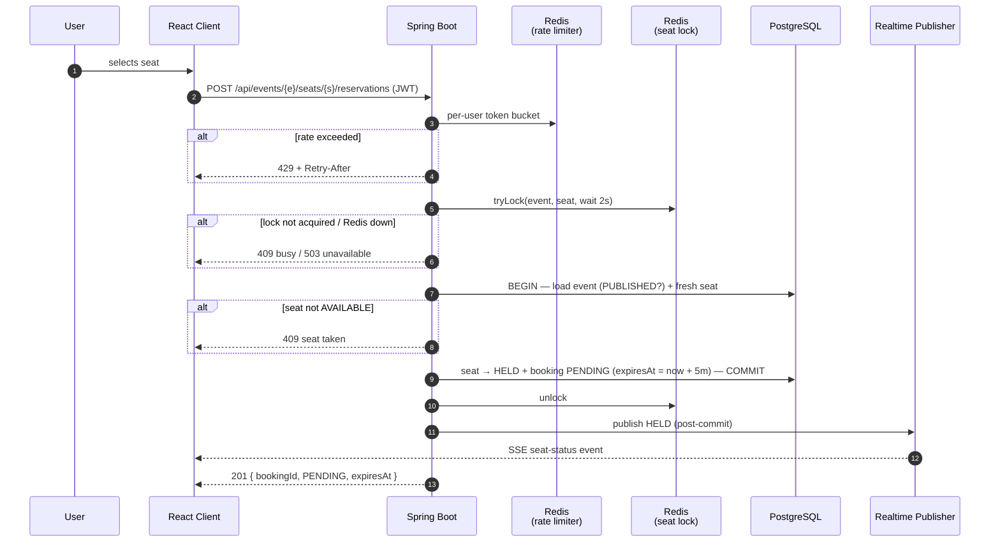
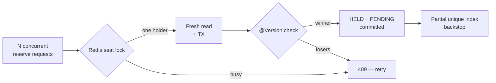
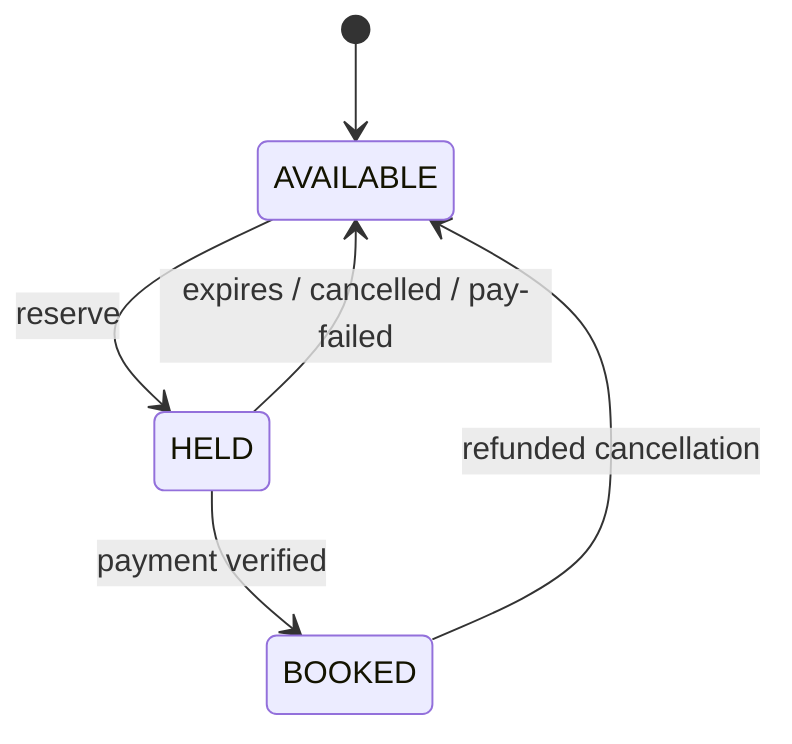
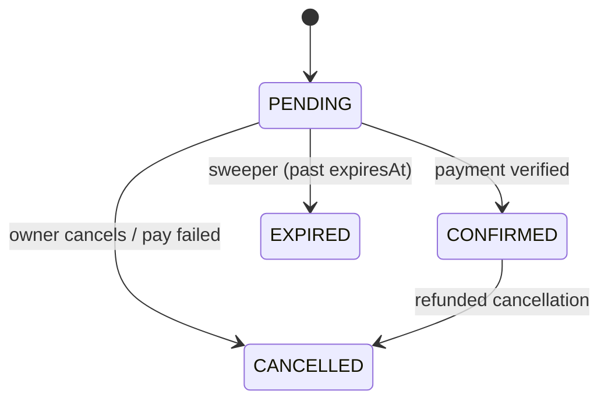
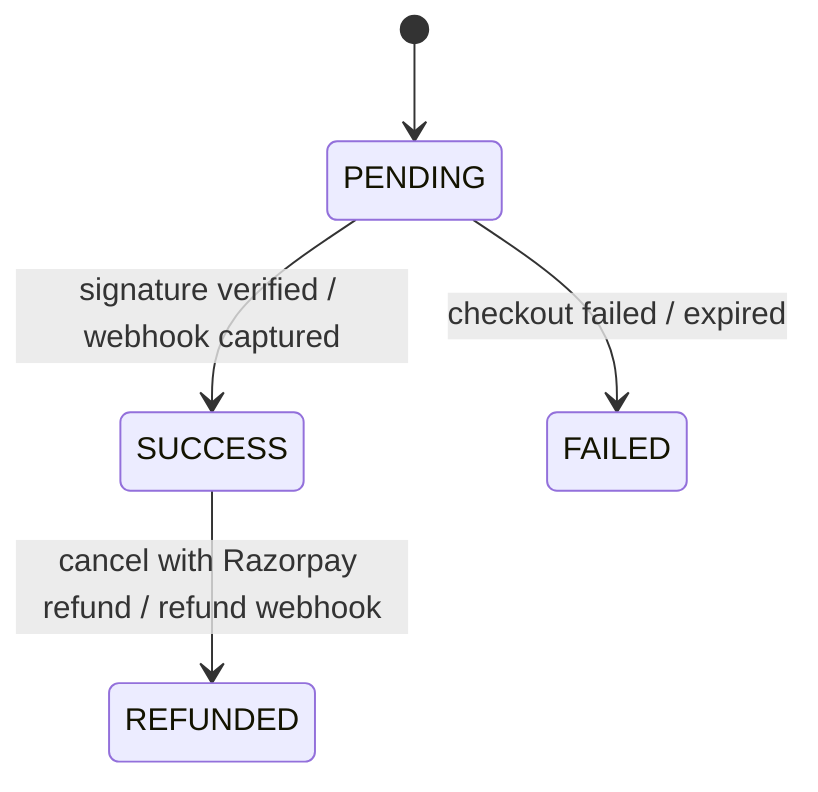
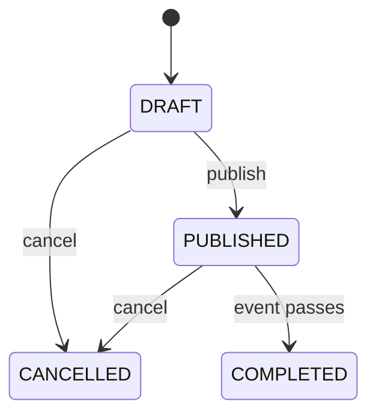
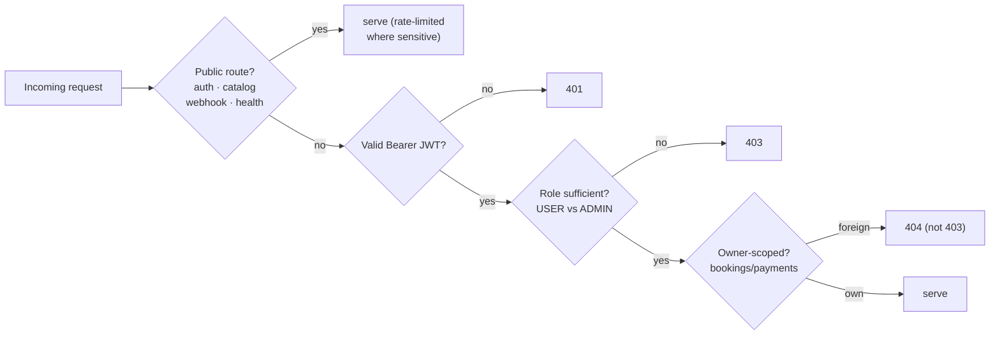
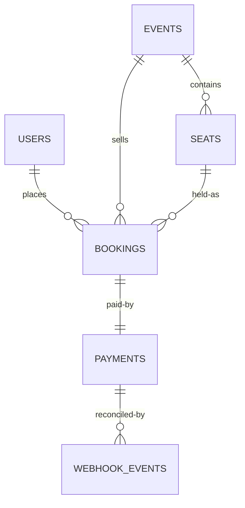

<div align="center">

# 🎟️ FlashReserve

### High-Throughput Flash-Sale & Ticket Reservation Engine

A concurrency-safe ticket reservation platform designed to survive flash-sale traffic spikes — many buyers racing for few seats — **without overselling a single seat**.


**[Snapshot](#-product-snapshot) · [Architecture](#-system-architecture) · [Reservation Engine](#-reservation-workflow) · [Payments](#-payment-architecture) · [Realtime](#-realtime--live-seat-availability) · [Security](#-security-architecture) · [API](#-api-reference) · [Deployment](#-deployment) · [Testing](#-testing) · [Roadmap](#-roadmap)**

</div>

---

## 📸 Product Snapshot

| Problem | FlashReserve Solution |
|---|---|
| Seat overselling under contention | Redis distributed lock + PostgreSQL optimistic locking |
| Reservation floods during flash sales | Per-user distributed token-bucket rate limiting |
| Stale temporary holds | Scheduled transactional expiration with race-safe release |
| Payment races (pay vs. expire vs. cancel) | Serialized `PESSIMISTIC_WRITE` state transitions |
| Fake client-side payment success | Server-side Razorpay HMAC signature verification |
| Provider callbacks drifting from local state | Verified webhook reconciliation with event deduplication |
| Stale seat maps across browsers | SSE + Redis pub/sub fan-out after commit |
| State inconsistency | PostgreSQL as the single source of truth |

> **PostgreSQL is the source of truth.** Redis coordinates (locks, rate limits, OTP, realtime fan-out) — it never owns seat, booking, or payment state.

---

## ✨ Why FlashReserve?

Most ticket-booking demos are CRUD with a checkout button. FlashReserve is built around the problem that makes flash sales genuinely hard:

- **Inventory contention** — hundreds of concurrent buyers racing for the same seat, absorbed by a per-seat distributed lock *before* the database is touched.
- **Distributed coordination** — Redisson locks, token buckets, OTP state, and realtime fan-out share one Redis client; correctness never depends on Redis holding authoritative state.
- **Transactional correctness** — seat mutation and booking creation commit atomically; optimistic-version conflicts roll both back together with a clean `409`.
- **Idempotent, replay-safe payments** — order reuse, signature verification, and transitions that can be retried without double-confirming.
- **Asynchronous expiration** — a sweeper releases unpaid holds without racing live payments or cancellations, retrying safely on its next pass.
- **Provider reconciliation** — Razorpay webhooks are HMAC-verified, deduplicated by event id, and reconciled against local state instead of blindly trusted.
- **Live inventory** — every committed seat change fans out over SSE so all browsers converge on the same seat map.
- **Abuse protection** — per-user reservation buckets plus per-IP auth buckets, enforced in a fail-closed way.
- **Deployment hardening** — Docker multi-stage build, non-root runtime, production profile with no JWT fallback, CORS allow-list, health-only Actuator.

---

## 🧩 Feature Grid

<table>
<tr>
<td width="50%">

**🎟️ Flash-Sale Reservation**
Temporary `PENDING` holds with server-side expiry, not client timers.

**🔒 Distributed Seat Locking**
Per-seat Redisson lock absorbs cross-instance contention before the DB.

**⚡ Optimistic Concurrency Control**
`@Version` on seats is the final no-oversell authority; losers get `409`.

**⏳ Automatic Hold Expiration**
Scheduled sweeper releases unpaid holds transactionally, race-safe.

**💳 Razorpay Test Payments**
Server-created orders; amounts always come from server-side pricing.

**🪝 Webhook Reconciliation**
HMAC-verified callbacks deduplicated and reconciled with local state.

**📡 Live Seat Availability**
SSE streams versioned seat events; Redis pub/sub fans out across instances.

</td>
<td width="50%">

**🚦 Distributed Rate Limiting**
Token buckets for reservations (per user) and auth (per IP), fail-closed.

**🔐 JWT Authentication**
Stateless Bearer tokens, BCrypt hashing, Gmail-OTP registration, password recovery.

**👤 Owner-Scoped Bookings**
Foreign booking ids are indistinguishable from missing ones (`404` for both).

**🗄️ PostgreSQL + Flyway**
`ddl-auto=validate`; every schema change is a versioned migration.

**📖 OpenAPI / Swagger**
Every endpoint documents roles, parameters, and error responses in dev.

**🛡️ Production Security**
No JWT fallback in production, CORS allow-list, secrets never committed.

**🚀 Docker Deployment**
Multi-stage build, non-root runtime, `PORT`-aware, health-checked.

</td>
</tr>
</table>

---

## 🏗️ System Architecture



**Design rule:** every read that matters hits PostgreSQL. Redis failures fail closed (`503`) on the reservation path rather than letting requests proceed uncoordinated.

---

## 🎯 The Core Problem

Flash sales break naive booking code. One seat, hundreds of buyers, milliseconds of contention:

```text
❌ Naive (unsafe)

check seat → if AVAILABLE → book seat
                 ↑ race window here: N buyers all see AVAILABLE
```

Two requests can both read `AVAILABLE` before either writes — and the seat gets sold twice.

### FlashReserve's correctness model

```text
✅ FlashReserve

Request
  ↓
Rate Limit (per-user token bucket, fail-closed)
  ↓
Distributed Seat Lock (per event+seat, bounded wait)
  ↓
Fresh Seat Read (inside the lock, inside a transaction)
  ↓
Verify AVAILABLE (else 409)
  ↓
Optimistic Version Check (Seat @Version, final arbiter)
  ↓
Transactional Seat + Booking Update (atomic commit)
  ↓
Release Lock
  ↓
Realtime Seat Update (post-commit, best-effort fan-out)
```

> **Why this document is in the public record:** a [concurrency test suite](#-testing) hammers this path with parallel reservation attempts, and a partial unique index (`uk_bookings_one_pending_per_seat`) stands behind the application logic as a database-level backstop.

---

## 🔁 Reservation Workflow



<details>
<summary><b>Exact mechanics (verified in code)</b></summary>

- **Lock key:** `flashreserve:reservation:event:{eventId}:seat:{seatId}` — per-seat, stable across instances.
- **Wait:** bounded (`reservation.lock-wait-duration`, default `2s`); no explicit lease — Redisson watchdog holds until `unlock`, released only if held by the current thread.
- **Transaction:** seat `AVAILABLE → HELD` and `PENDING` booking creation commit atomically via `TransactionTemplate` *inside* the lock.
- **Hold duration:** `reservation.hold-duration` (default `5m`); **sweep interval:** `reservation.expiration-interval` (default `30s`).
- **Rate limit:** `reservation.rate-limit` (default `10 req / 1s` per user).
- **Failure modes:** Redis unreachable → `503` (fail-closed, never proceed unlocked); version conflict → `409`; duplicate pending → `409` via partial unique index.

</details>

---

## 🛡️ Concurrency & No-Overselling

Five complementary layers — each with a distinct job, none redundant:

| # | Layer | Job |
|---|---|---|
| 1 | **Redis distributed lock** | Absorbs cross-instance contention *before* the database; bounds the race window |
| 2 | **PostgreSQL optimistic locking** | `Seat.@Version` is the final correctness authority — exactly one racer wins |
| 3 | **Database transaction** | Seat change + booking creation are atomic; partial states are impossible |
| 4 | **Ownership checks** | Users can only read/mutate their own bookings; foreign ids return `404` |
| 5 | **Database constraints** | Partial unique index allows only one `PENDING` booking per seat; unique email ends registration races |



---

## 🔄 State Machines

Only states that exist in code are shown.

### Seat lifecycle



### Booking lifecycle



### Payment lifecycle



> Terminal states (`SUCCESS`, `REFUNDED`, `FAILED`) are never overwritten by stale transitions — every mutation runs under `PESSIMISTIC_WRITE` and is idempotent, so retries and replays are safe.

### Event lifecycle (admin)



Only `PUBLISHED` events are visible on the public catalog; admin reads bypass that filter.

---

## ⏳ Hold Expiration

Unpaid holds must die on their own — but the sweeper must never steal a seat from a live payment or cancellation.

- **Scheduled sweep** every `reservation.expiration-interval` (default `30s`) scans due holds via an indexed `expires_at` lookup.
- **One transaction per booking:** re-checks `PENDING` + past `expiresAt` under lock; a seat already `BOOKED` is never released.
- **Race handling:** if the seat row was concurrently modified, the optimistic lock fails and *both* changes roll back; the job logs a warning and retries on its next pass with fresh state.
- **Atomic triple update:** seat `HELD → AVAILABLE`, booking `→ EXPIRED`, payment `PENDING → FAILED` commit together, then an `AVAILABLE` event is published.

```mermaid
sequenceDiagram
    autonumber
    participant J as Scheduler (30s)
    participant PG as PostgreSQL
    participant RT as Realtime Publisher
    J->>PG: find due holds (PENDING, expiresAt &lt; now)
    loop per booking
        J->>PG: BEGIN — re-check PENDING + expired
        alt seat already BOOKED
            PG-->>J: skip (never release paid seats)
        else seat concurrently modified
            PG-->>J: optimistic-lock conflict → rollback → retry next pass
        else
            PG-->>J: seat→AVAILABLE, booking→EXPIRED, payment→FAILED — COMMIT
            J->>RT: publish AVAILABLE (post-commit)
        end
    end
```

---

## 💳 Payment Architecture

Razorpay **TEST MODE only** — no real money, ever.

```text
Booking PENDING
      ↓
Create / reuse payment  (one payment per booking, unique constraint)
      ↓
Server creates Razorpay order  (amount from server-side ticket price, paise)
      ↓
Client completes TEST checkout  (key id only — secret never leaves server)
      ↓
Client sends payment result
      ↓
Server validates order association  (order id must match stored order)
      ↓
Server verifies HMAC-SHA256 signature  (order_id | payment_id, MessageDigest.isEqual)
      ↓
Serialized payment transition  (PESSIMISTIC_WRITE, idempotent)
      ↓
Booking CONFIRMED + Seat BOOKED  (+ SSE fan-out)
```

### Webhook reconciliation

```text
Razorpay Webhook  POST /api/webhooks/razorpay
      ↓
Raw payload bytes preserved for HMAC
      ↓
Signature verification  (HMAC-SHA256, webhook secret, constant-time compare)
      ↓
Event-id validation + deduplication  (unique razorpay_event_id, persisted)
      ↓
payment.captured → confirm  ·  payment.failed → fail  ·  refund.created → reconcile
      ↓
Safe local transition  (unknown orders → IGNORED, never crash the booking)
```

**Trust guarantees (all verified in code):**

- Amount always comes from the event's server-side ticket price — the client never supplies one.
- The Razorpay **key secret never leaves the server**; clients see only the public key id in the initiation response.
- A client **cannot declare success independently** — confirmation requires a valid HMAC signature.
- Webhook authenticity is verified before parsing; missing secret → `401`, missing event id / bad JSON → `400`.
- `CONFIRMED` cancellation refunds through Razorpay *first*, then applies the local `CANCELLED`/`REFUNDED` transition (rejected after event start or on refund failure).

<details>
<summary><b>Cancellation & refund rules</b></summary>

- `PENDING` bookings: owner cancels → seat released, booking `CANCELLED`, payment `FAILED` — all atomically.
- `CONFIRMED` bookings: full Razorpay refund is issued first (`speed=normal`); only then seat `BOOKED → AVAILABLE`, booking `→ CANCELLED`, payment `→ REFUNDED` with the stored refund id.
- A `refund.created` webhook reconciles the same transition if the refund originated provider-side.

</details>

---

## 📡 Realtime / Live Seat Availability

Every committed seat change converges all browsers via **SSE** (not WebSockets) with Redis pub/sub for multi-instance fan-out:

```text
Reservation / Cancellation / Expiration / Payment
                    ↓
             Seat status changed
                    ↓
          PostgreSQL transaction COMMITS
                    ↓
          post-commit seat event (versioned)
                    ↓
     Local fan-out + Redis RTopic (flashreserve:seat-updates)
                    ↓
            All instances fan out locally
                    ↓
         SSE → GET /api/events/{id}/seat-updates
                    ↓
             Connected browsers merge by seatVersion
```

- **PostgreSQL remains the source of truth** — realtime is freshness/UI sync; publication failures never corrupt reservation correctness.
- Events carry `{ seatId, seatNumber, status, seatVersion }`; clients ignore stale versions and refetch the REST snapshot on reconnect.
- SSE endpoint is public (same as the seat map) but carries no PII; the stream is capped (`500` per event, `2000` global, else `429`).
- Redis pub/sub is a transient transport, not persistent event storage — own-instance echoes are dropped.

---

## 🚦 Rate Limiting

Distributed token buckets (Redisson `RRateLimiter`) shared across instances — critical during flash-sale floods:

| Protected Flow | Strategy | Default |
|---|---|---|
| Reservation | per-user token bucket | `10 req / 1s` |
| Login | per-IP token bucket | `20 req / 1m` |
| Registration | per-IP token bucket | `10 req / 1m` |

- Exceeding a bucket returns **`429 Too Many Requests` + `Retry-After`** header.
- Redis failures fail **closed** (`503`) — flood protection never silently disappears.
- Client identity is the direct remote address; `X-Forwarded-For` is never trusted.
- All limits are configurable via properties (`RESERVATION_*`, `AUTH_*` env overrides).

---

## 🔐 Security Architecture



- **JWT Bearer** auth (`Authorization: Bearer <JWT>`), stateless sessions, CSRF disabled (token API); secrets `≥ 32 bytes`, placeholder values rejected at startup.
- **Roles:** `USER` (reservations, bookings, payments) and `ADMIN` (event management, read-only booking oversight, dashboard) — no self-service path to `ADMIN`.
- **Generic login failures** (`401` without revealing whether email or password was wrong) and **owner-scoped lookups** prevent account/booking enumeration.
- **Default deny:** anything not explicitly permitted is denied; unknown non-API paths are denied outright.
- **Razorpay isolation:** key secret and webhook secret are backend-only env vars, never in responses, logs, or frontend bundles.
- **CORS allow-list:** explicit origins only (`*` is filtered out); empty means CORS off (local dev uses the Vite proxy); production with empty origins fails fast.
- **Actuator** exposes health only; **Swagger/OpenAPI is disabled in production** (endpoints return `404`).
- **No secrets committed:** `application.properties` and `.env` files are git-ignored; only placeholder examples are tracked; the build excludes local properties from the JAR.

---

## 📖 API Reference

> Interactive docs in development: **Swagger UI** at `http://localhost:8080/swagger-ui/index.html` · **OpenAPI JSON** at `http://localhost:8080/v3/api-docs`. Paste a login JWT into *Authorize* to call protected endpoints. Standard error shape `ApiError{timestamp,status,error,message,path,fieldErrors}` with `400 / 401 / 403 / 404 / 409 / 429 / 503`.

| Area | Base Path | Access | Purpose |
|---|---|---|---|
| Auth | `/api/auth` | Public | OTP registration, login, password recovery |
| Events | `/api/events` | Public | Published catalog, detail, seat map, SSE stream |
| Reservations | `/api/events/{e}/seats/{s}/reservations` | USER | Temporary seat holds |
| Bookings | `/api/bookings` | USER | Own bookings, detail, cancellation |
| Payments | `/api/bookings/{id}/payment…` | USER | Order initiation + signature verification |
| Webhooks | `/api/webhooks/razorpay` | HMAC | Provider reconciliation (no JWT) |
| Admin | `/api/admin` | ADMIN | Events, bookings, dashboard |
| Health | `/actuator/health` | Public | Liveness / readiness only |

<details>
<summary><b>🔑 Authentication</b></summary>

| Method | Path | Purpose |
|---|---|---|
| POST | `/api/auth/register/send-otp` | Send Gmail OTP (rate-limited per IP) |
| POST | `/api/auth/register/verify-otp` | Verify OTP, unlock registration |
| POST | `/api/auth/register` | Create USER account, returns JWT (`409` on duplicate email) |
| POST | `/api/auth/login` | Authenticate, returns JWT (`429` rate-limited per IP) |
| POST | `/api/auth/forgot-password/send-otp` | Send recovery OTP (always `202`, no account leak) |
| POST | `/api/auth/forgot-password/verify-otp` | Verify OTP, returns recovery token |
| POST | `/api/auth/forgot-password/reset` | Reset password with recovery token |

</details>

<details>
<summary><b>🎪 Events, seats & realtime</b></summary>

| Method | Path | Purpose |
|---|---|---|
| GET | `/api/events?page&size&sort` | Paginated published events (size clamped to 100) |
| GET | `/api/events/{eventId}` | Published event detail |
| GET | `/api/events/{eventId}/seats[?status=]` | Seat map, optional `AVAILABLE\|HELD\|BOOKED` filter |
| GET | `/api/events/{eventId}/seat-updates` | SSE stream (`text/event-stream`, named `seat-status` events) |

</details>

<details>
<summary><b>🎟️ Reservations & bookings</b></summary>

| Method | Path | Purpose |
|---|---|---|
| POST | `/api/events/{eventId}/seats/{seatId}/reservations` | Reserve a seat → `201` hold (`409` taken/busy, `429` limited, `503` Redis down) |
| GET | `/api/bookings?page&size&sort` | Caller's own bookings, paginated |
| GET | `/api/bookings/{bookingId}` | One owned booking (`404` for foreign or missing) |
| POST | `/api/bookings/{bookingId}/cancel` | `PENDING` → release; `CONFIRMED` → refund-then-cancel |

</details>

<details>
<summary><b>💳 Payments & webhooks</b></summary>

| Method | Path | Purpose |
|---|---|---|
| POST | `/api/bookings/{bookingId}/payment` | Create/reuse Razorpay TEST order (amount server-side) |
| POST | `/api/bookings/{bookingId}/payment/verify` | Verify checkout signature → confirm (replay-safe) |
| POST | `/api/webhooks/razorpay` | HMAC-verified reconciliation (`X-Razorpay-Signature`, `X-Razorpay-Event-Id`) |

</details>

<details>
<summary><b>🛠️ Admin</b></summary>

| Method | Path | Purpose |
|---|---|---|
| POST | `/api/admin/events` | Create DRAFT event with seat inventory (`201` + `Location`) |
| GET | `/api/admin/events[?status=]` | All events regardless of status, paginated |
| GET | `/api/admin/events/{eventId}` | One admin event |
| PUT | `/api/admin/events/{eventId}` | Update event |
| PATCH | `/api/admin/events/{eventId}/publish` | Publish |
| PATCH | `/api/admin/events/{eventId}/cancel` | Cancel |
| GET | `/api/admin/bookings[?status=&eventId=]` | All bookings, read-only |
| GET | `/api/admin/bookings/{bookingId}` | One booking, read-only |
| GET | `/api/admin/dashboard` | Metrics snapshot (counts, revenue, newest bookings) |

</details>

---

## 🧠 Architecture Decision: Single Service

FlashReserve deliberately uses **no Kafka, no RabbitMQ, no WebSockets, no microservices**.

> The correctness-critical booking path stays in one Spring Boot service: PostgreSQL transactions provide authority, Redis provides distributed coordination.

This is appropriate for the current scope — a single deployable with strong local transaction guarantees is *more* correct than a distributed saga for seat inventory. Event-driven messaging and horizontal-scaling patterns are future options (see [Roadmap](#-roadmap)), adopted when scale demands them, not before.

---

## 🗄️ Database / Flyway

- **PostgreSQL is the source of truth** for seats, bookings, payments, and webhook events. Hibernate runs with **`ddl-auto=validate`** — it never modifies DDL.
- **Flyway owns the schema:** `V1__initial_schema.sql` (users, events, seats, bookings, payments + checks, uniques, indexes) and `V2__razorpay_webhook_reconciliation.sql` (`webhook_events` + Razorpay order/payment indexes).
- **Key indexes:** `ix_events_status_event_date`, per-scope booking indexes (`user/event/seat/status`), `ix_bookings_expires_at` (sweeper), `ix_payments_razorpay_order_id/payment_id`, webhook order/payment indexes.
- **Integrity constraints:** `uk_users_email`, `uk_seats_event_id_seat_number`, `uk_payments_booking_id` (one payment per booking), partial unique `uk_bookings_one_pending_per_seat` (validated at startup — boot fails if missing), `uk_webhook_events_razorpay_event_id` (dedupe).
- **Optimistic locking:** `Seat` carries `@Version` — the only entity that needs it, since seats are the contention point.



---

## 🧰 Technology Stack

| Layer | Technologies |
|---|---|
| Backend | Java 17, Spring Boot 4.1.1 (Web MVC, Security, Data JPA, Validation, Actuator) |
| Security | Spring Security, JJWT 0.13.0, BCrypt |
| Persistence | PostgreSQL, Spring Data JPA, Hibernate (`validate`) |
| Migrations | Flyway (+ `flyway-database-postgresql`) |
| Coordination | Redis via Redisson 3.50.0 (locks, rate limits, OTP, pub/sub) |
| Payments | Razorpay Java SDK 1.4.10 — **TEST MODE only** |
| API Docs | Springdoc OpenAPI 3.1.0 (disabled in production) |
| Realtime | SSE (`SseEmitter`) + Redis `RTopic` |
| Mail | Spring Mail via Gmail SMTP (OTP + recovery) |
| Frontend | React 19.2.8, React Router 7.18.3, Vite 8.2.2, native `fetch` |
| Tooling | Maven Wrapper, Oxlint 1.79.0, Docker multi-stage |

---

## 🗂️ Project Structure

```text
Flash-Reserve/
├── backend/
│   ├── src/main/java/com/soubhagya/flashreserve/
│   │   ├── config/        # security, CORS, Redis, Razorpay, reservation tuning, production guard
│   │   ├── controller/    # auth, events, reservations, bookings, payments, webhooks, admin, SSE
│   │   ├── service/       # reservation, payment, transitions, expiration, OTP, rate limit, realtime
│   │   ├── payment/       # Razorpay provider + webhook signature verifier
│   │   ├── repository/    # Spring Data JPA (incl. PESSIMISTIC_WRITE queries)
│   │   ├── entity/        # JPA entities + enums (Seat carries @Version)
│   │   ├── security/      # JWT filter/service, entry point, access-denied handler
│   │   ├── dto/           # auth, event, booking, payment, error (ApiError)
│   │   └── exception/     # typed exceptions → status-code mapping
│   ├── src/main/resources/
│   │   ├── application-example.properties   # placeholders only (tracked)
│   │   └── db/migration/  # V1__initial_schema.sql, V2__razorpay_webhook_reconciliation.sql
│   ├── src/test/          # 45 test classes (integration, concurrency, unit)
│   ├── Dockerfile         # multi-stage, non-root runtime
│   └── pom.xml
├── frontend/
│   ├── src/
│   │   ├── pages/         # landing, events, event-detail, bookings, dashboard, auth, admin
│   │   ├── components/    # seat-map, reservation-panel, payment cards, admin tables, UI kit
│   │   ├── hooks/         # useSeatUpdates (SSE), useLiveSeats, usePayment, useCountdown
│   │   ├── services/      # apiClient, auth, events, reservations, bookings, payments, checkout
│   │   └── auth/          # context, provider, route guards (RequireAuth/RequireAdmin)
│   ├── vite.config.js     # dev proxy /api → localhost:8080
│   └── package.json       # React 19 + Vite 8 + React Router 7 + Oxlint
└── README.md
```

---

## 🖥️ Product Tour

> No screenshots are committed to this repository — what follows is the real, implemented user journey (every route below exists in `frontend/src`).

| Journey | Route | What happens |
|---|---|---|
| Discover | `/` | Landing with hero, capability strip, how-it-works, feature showcase |
| Browse | `/events` | Published-event catalog grid with skeletons + retry |
| Select | `/events/:eventId` | Seat map + reservation panel with hold countdown; live SSE conflict notices |
| Pay | `/bookings`, `/bookings/:bookingId` | Own bookings, inline Razorpay TEST checkout, cancel |
| Track | `/dashboard` | Booking overview, pending-payment nudges, upcoming/recent |
| Join | `/register`, `/login`, `/forgot-password` | Gmail-OTP registration, login, OTP password recovery |
| Operate | `/admin`, `/admin/events`, `/admin/bookings` | Metrics, event lifecycle (draft → publish → cancel), read-only booking oversight |

The UI is responsive (hamburger nav, fluid `clamp()` type, breakpoints down to small phones, `prefers-reduced-motion` support).

---

## ⚙️ Development / Configuration

**Prerequisites:** Java 17 · PostgreSQL · Redis (Docker is easiest) · Node 18+ · Razorpay TEST keys (optional, payments only).

`backend/src/main/resources/application.properties` is **git-ignored** — copy placeholders from `application-example.properties` (never commit real values):

| What | Property | Notes |
|---|---|---|
| Database URL | `spring.datasource.url` | `jdbc:postgresql://localhost:5432/flashreserve` |
| DB credentials | `spring.datasource.username` / `password` | local only |
| JWT secret | `jwt.secret` | `≥ 32` chars, e.g. `openssl rand -base64 64` |
| Razorpay keys | `razorpay.key-id` / `razorpay.key-secret` | TEST MODE, local only |
| Webhook secret | `razorpay.webhook-secret` | from Razorpay Dashboard → Webhooks |
| Redis | `spring.data.redis.host` / `port` | default `localhost:6379` |
| Mail (OTP) | `MAIL_USERNAME` / `MAIL_PASSWORD` | Gmail address + App Password |
| CORS | `CORS_ALLOWED_ORIGINS` | empty locally (Vite proxy); explicit origins in production |
| Hold duration | `reservation.hold-duration` | default `5m` |
| Sweep interval | `reservation.expiration-interval` | default `30s` |
| Rate limits | `reservation.rate-limit.*`, `auth.*.capacity` | see example file |

Secrets also resolve from environment (`JWT_SECRET`, `REDIS_HOST`, `DATABASE_URL`, …).

```bash
# Backend (http://localhost:8080)
cd backend
./mvnw.cmd spring-boot:run        # Windows
./mvnw spring-boot:run            # Linux/macOS

# Frontend (http://localhost:5173, proxies /api → :8080)
cd frontend
npm install
npm run dev
```

---

## 🧪 Testing

**330 backend tests across 45 classes — all passing** (plus 14 frontend unit tests for the SSE seat-update reducer). Tests need reachable PostgreSQL + Redis; a few config/CORS/Redis unit tests run without a DB.

| Area | Coverage |
|---|---|
| Reservation | integration, rate-limit, lock service, proxy identity |
| Concurrency | parallel reservation, payment, cancellation, registration races |
| Payments | initiation, verification, replay-safety, concurrency, refunds |
| Webhooks | signature, dedupe, capture/fail/refund reconciliation, persistence |
| Realtime | seat-update publication across reservation/cancel/expire/pay paths |
| Auth & OTP | registration OTP, forgot-password, auth rate limits, JWT service |
| Admin & events | CRUD lifecycle, pagination bounds, dashboard, rollback |
| Security & docs | security filter chain, CORS (incl. production guard), Swagger docs |
| Frontend | 14 `node:test` unit tests for SSE merge/conflict logic |
| Lint | Oxlint (`npm run lint`), Vite build (`npm run build`) |

```bash
cd backend
./mvnw.cmd clean test             # Windows (full suite)
./mvnw clean test                 # Linux/macOS

cd ../frontend
npm run lint
npm run build
```

> **Known local flake:** the full backend suite opens one Hikari pool (`maximum-pool-size=5`) per `SpringBootTest` context; running everything in parallel against a local PostgreSQL with `max_connections=100` can hit `too many clients`. Mitigate with `-Dtest=…`, sequential runs, or a higher `max_connections`. Not a production concern (single pool per deploy).

---

## 🚀 Deployment

**Status: deployment-ready, not yet deployed.** There is no live production URL — the repository contains the complete preparation, and you bring the accounts.

Prepared topology:

```text
Browser (Vercel static: React + Vite)
      │  VITE_API_BASE_URL = https://<render-backend>.onrender.com
      ▼
Render Web Service (Docker: Spring Boot 4.1.x, Java 17)
      │  jdbc:postgresql + sslmode=require     redis:// / rediss://
      ▼                                        ▼
Supabase PostgreSQL                   Render Key Value (Redis)
      │
      └── Razorpay TEST MODE (order create + signature verify + webhook)
```

| Concern | How it's handled (verified in repo) |
|---|---|
| Image | `backend/Dockerfile`: `maven:3.9` build → `eclipse-temurin:17-jre` runtime, non-root `appuser` |
| Secrets | Never baked in — POM excludes `application.properties`, copies the *example* at build time |
| Port | `server.port=${PORT:8080}` (Render injects `PORT`) |
| Profile | `SPRING_PROFILES_ACTIVE=production` → Swagger off, JWT bound strictly to `JWT_SECRET` (boot fails on missing/placeholder) |
| CORS | `CORS_ALLOWED_ORIGINS=https://<vercel-app>.vercel.app` (explicit allow-list, `*` rejected) |
| Database | Full JDBC URL with `?sslmode=require` via `DATABASE_URL` + `DB_USERNAME`/`DB_PASSWORD` |
| Redis | `REDIS_HOST/PORT/PASSWORD/SSL_ENABLED` — internal `redis://` or external `rediss://` |
| Health | `GET /actuator/health` (only endpoint exposed) as the Render health check |
| Frontend | Vercel preset Vite (`npm run build` → `dist`), single env var `VITE_API_BASE_URL` |

---

## ⚠️ Limitations

Honest constraints, verified against the repo:

- **TEST MODE payments only** — no real-money processing; production Razorpay is future work.

- **Redis is required** — reservation and auth rate limiting fail closed (`503`) without it.
- **Single service** — no Kafka/RabbitMQ, no WebSocket transport (SSE only), no microservices (deliberate — see above).
- **Realtime is best-effort UI sync** — SSE + transient pub/sub; PostgreSQL stays authoritative, and clients refetch on reconnect.
- **Gmail-only OTP mail** — registration/recovery mail goes through Gmail SMTP with an App Password.
- **Frontend maturity** — full user + admin journeys exist, but no E2E suite yet (14 unit tests + Oxlint).

---

## 🗺️ Roadmap

Implemented functionality is above; these are genuinely future items:

- Production Razorpay processing (live keys, settlement + refund ops tooling)
- Webhook/event observability (delivery dashboards, alerting on `IGNORED` spikes)
- Horizontal scaling story (lock-lease tuning, sticky vs. stateless SSE, load-test numbers)
- Externalized messaging if scale demands it (outbox / event bus for seat events)
- Distributed tracing + richer metrics beyond health
- Richer storefront experience (search, filters, seat tiers, promo inventory strategies)
- End-to-end coverage (Playwright over reserve → pay → webhook → expire paths)

---

## 🏆 Engineering Highlights

| Challenge | FlashReserve Approach |
|---|---|
| Overselling | Redis per-seat lock + `@Version` optimistic locking + partial unique index |
| Flash-sale contention | Distributed coordination + per-user token buckets, fail-closed |
| Hold expiration | Scheduled, transactional, race-safe sweeper with next-pass retry |
| Payment trust | Server-side orders, server-side pricing, HMAC signature verification |
| Payment races | `PESSIMISTIC_WRITE` serialized transitions, idempotent + replay-safe |
| Provider callbacks | HMAC-verified webhook with event-id dedupe + state reconciliation |
| Live inventory | SSE + Redis pub/sub fan-out, versioned merge, PostgreSQL authoritative |
| DB evolution | Flyway migrations + Hibernate `validate`, startup integrity guard |
| Production security | Secret externalization, no-fallback JWT, CORS allow-list, Swagger off |

---

<div align="center">

### ⭐ Star History

If this project helped you understand flash-sale concurrency, payments, or realtime inventory — consider starring it.

[](https://star-history.com/#soubhagya-behera/Flash-Reserve&Date)

**FlashReserve — built by Soubhagya Kumar Behera**

*Java Full Stack Developer · Spring Boot · Distributed Systems · PostgreSQL · React*

[](https://github.com/soubhagya-behera)
[](https://www.linkedin.com/in/soubhagya-behera)

</div>
